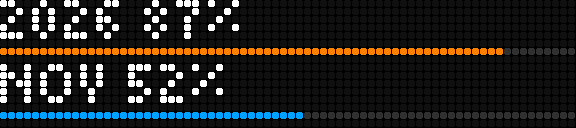
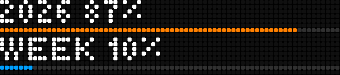
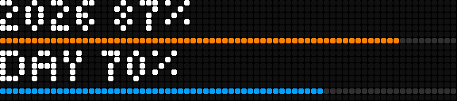
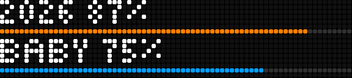
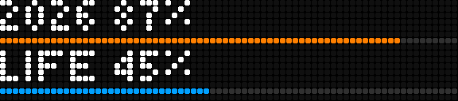
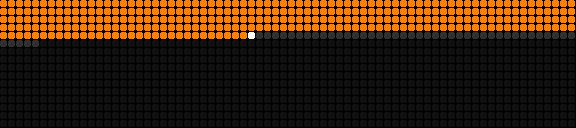
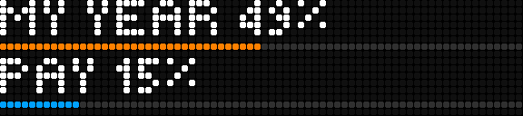
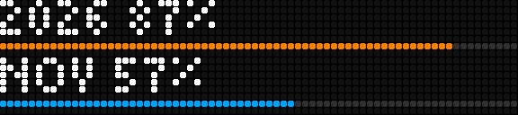

# Time Progress

How much of the year, month, week, day, your life or any span has passed.



The front display keeps the year on top and a second line under it: the month, the week, the day, a span of your own or your life. Turn the wheel to change the second line or to switch to a picture with a pixel for every day of the year or every month of your life. Your own span and your life appear once their dates are set in the settings.

A JavaScript app for [BUSY Bar](https://busy.app).

## What the bar shows

The app starts on the year and the month: each line is a label with the percent that has passed and a bar across the display under it, orange for the year and blue for the second line. The month runs from its first day to the next month's first day. The display is redrawn every minute.

One click of the wheel puts the week under the year. Weeks start on Monday at midnight.



The next click shows the day, from midnight to midnight.



With both dates of your own span set, the next line is that span under its label, here BABY from April 20, 2026 to January 25, 2027.



With a birth date set, the next line is your life: from your birth date to the birthday the set number of years later.



Then the whole display becomes the days of the year, one pixel each, row by row from the top left: the days that have passed in orange, today in white, the rest of the year dim.



With a birth date set, the last view is the months of your life the same way: the months lived in blue, this month in white, the rest dim. 80 years make 960 pixels of the display's 1152.


The year can start on any day, such as your birthday, and the month on any day of the month, such as your payday; each can have a label of its own instead of the year and the month's name. Here the year starts on May 20 under the label MY YEAR and the month on the 12th under PAY.



When the year reaches a new whole percent, a white spark runs along its bar. The percent is checked once a minute, and the spark runs only while the year is on the display.



The app does not draw on the back display: the firmware shows its own copy of the front there.

## Buttons

| Button | What it does |
| --- | --- |
| Wheel | Steps through the views: month, week, day, own span, life, days of the year, months of life. The own span and the two life views are left out until their dates are set. |
| Back | Leaves the app. |

## Settings

| Setting | What it does |
| --- | --- |
| Year starts on | The day the year starts, as MM-DD, such as 05-20 for a birthday. Empty, the default: January 1. A year from February 29 starts on the 28th in other years. |
| Year label | Up to 8 letters shown instead of the year. Empty, the default: the year, such as 2026. |
| Month starts on day | The day of the month the month starts, such as a payday; in shorter months, their last day. Default: 1. |
| Month label | Up to 8 letters shown instead of the month, such as PAY. Empty, the default: the month, such as NOV. |
| Own span label | Up to 8 letters for your own span, such as BABY. Empty by default. |
| Own span starts on | The first day of your own span, YYYY-MM-DD. Empty, the default: no own span. |
| Own span ends on | The day your own span ends, at its midnight, YYYY-MM-DD, later than the start. Empty by default. |
| Birth date | YYYY-MM-DD, for the life line and the months of life. Empty, the default: no life views. |
| Life, years | The span of the life views, 1 to 96 years. Default: 80. |

The app reads its settings when it starts.

## Data

None: it works offline. Time comes from the BUSY Bar's own clock.

## Build

Node 24 and npm:

```sh
npm ci
npm run build         # dist/io.github.vvzvlad.timeprogress.tgz
npm run app:install   # install it on a BUSY Bar connected over USB
npm run app:run       # start it
```

## License

[MIT](LICENSE)
